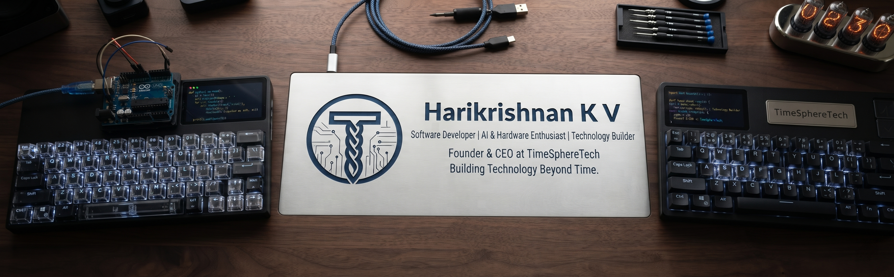

 <!-- ============================================ -->
<!-- HARIKRISHNAN K V - PERSONAL GITHUB PROFILE -->
<!-- Repository: HARIKRISHKV/HARIKRISHKV -->
<!-- ============================================ -->

<!-- PERSONAL BANNER -->

  

<!-- INTRODUCTION -->
<h1 align="center">Hi, I'm Hari 👋</h1>

<h3 align="center">
  Software Developer · AI & Hardware Enthusiast · Technology Builder
</h3>

  Building software, exploring emerging technologies, and turning ideas into reality.

<!-- CLICKABLE SOCIAL ICONS -->

  
  &nbsp;
  
  &nbsp;
  
  &nbsp;
  

---

## About Me

Hi, I'm **Hari**, a software developer and technology builder based in Bengaluru, India, working across full-stack development, AI, and hardware.

I'm the Founder & CEO at [TimeSphereTech](https://timespheretech.com/).

I enjoy turning ideas into software that is useful, reliable, and well designed. My work sits where three interests meet: full-stack web development, applied AI and automation, and hardware and IoT. I like understanding a system end to end, from the interface a person touches to the machine underneath it.

Alongside building, I'm growing as a founder: leading technology decisions, learning how products are shaped, and trying to make good engineering practical.

### Currently Interested In

- Full-stack application development
- Artificial intelligence and automation
- Hardware development and IoT
- Cloud computing and DevOps
- Cybersecurity and networking

---

## Technical Skills

### Languages

  

### Frontend Development

  

### Backend Development

  

### Databases

  

### Tools & Platforms

  

### AI & Hardware

  

- Applied AI and automation
- Hardware development and IoT
- ESP32 and embedded systems
- Hardware and software integration

---

## Areas of Interest

- Developing modern web applications.
- Exploring AI-powered software solutions.
- Building hardware-integrated projects.
- Learning cybersecurity and network technologies.
- Creating practical tools and innovative products.

---

## My Work

### Personal Website

[harikrishnankv.com](https://harikrishnankv.com/)

My personal website and portfolio.

### GitHub Repositories

Explore my development work, experiments, and projects.

  

Public repositories will be showcased here as they are published.

---

## Professional Affiliation

**Founder & CEO — [TimeSphereTech](https://timespheretech.com/)**

*Technology Beyond Time.*

---

## Connect With Me

  
  &nbsp;
  
  &nbsp;
  
  &nbsp;
  

  <i>Building thoughtfully. Learning continuously. Creating what matters.</i>

<!-- ============================================ -->
<!-- END OF PERSONAL GITHUB PROFILE README -->
<!-- ============================================ -->
